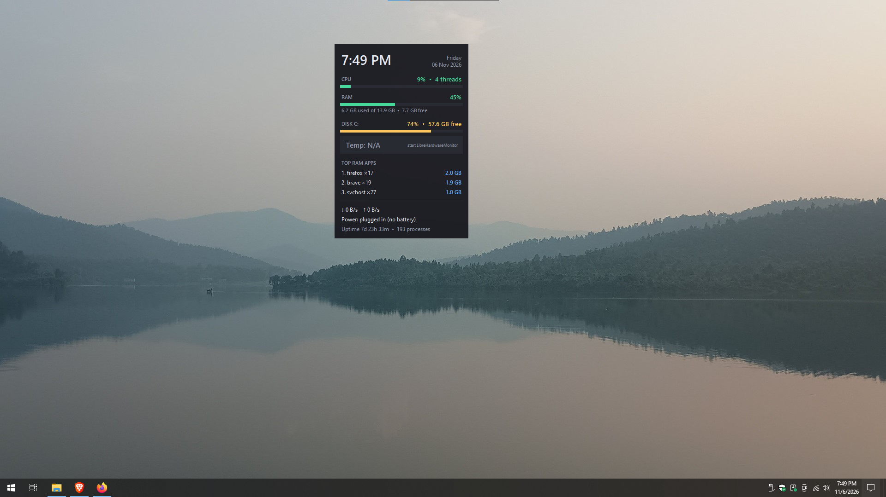

# PC Monitor Widget

A small, always-visible desktop widget for Windows 10/11 that shows live system stats: CPU, RAM, temperature, the apps using the most memory, and more. It is draggable, semi-transparent, and uses very little CPU itself.

<!-- Add a screenshot here after you upload it to the repo:

-->

## Features

- Clock and date
- CPU usage and RAM usage, with colour bars (green, yellow, red) and used/free memory
- CPU and GPU temperature
- Top 3 apps by RAM (all processes of one app are added together, e.g. `chrome x24`)
- Disk usage of the system drive
- Live download and upload speed
- Battery level and time left (or "plugged in" on desktops)
- Uptime and process count
- Right-click menu: always on top, lock position, opacity, start with Windows, open Task Manager, close
- Remembers its position and settings
- Only one copy can run at a time

## Quick start (one file, nothing else to install)

1. Go to the **Releases** page of this repository.
2. Download `PCMonitorWidget.exe`.
3. Double-click it and click **Yes** on the Windows permission prompt (see [Why administrator?](#why-administrator)).
4. The widget appears. On first run it sets up the temperature sensors by itself, which takes a few seconds, so "Temp" may say `waiting for sensors...` briefly.
5. Right-click the widget and tick **Start with Windows** if you want it to open automatically at sign-in (no permission prompt after that).

That's it. Python, LibreHardwareMonitor and the sensor driver are all included inside the exe.

### Why administrator?

Windows only lets programs with administrator rights read hardware temperatures. The widget asks once when it opens. If you click **No**, it still works but shows `Temp: N/A`.

> **Windows SmartScreen or antivirus warning?** Programs built with PyInstaller are sometimes flagged because they are new and unsigned. The full source is in this repository, and you can build the exe yourself (see [Build the exe yourself](#build-the-exe-yourself)) if you prefer.

## How temperature works

The exe bundles two free, open-source helpers and manages them for you:

- **LibreHardwareMonitor** reads the sensors. The widget starts it hidden in the tray and closes it when you close the widget.
- **PawnIO** is a small driver that lets it read CPU sensors. It is installed silently the first time you run the widget (it needs the administrator permission you already gave).

Nothing to download or start by hand. If you ever see `Temp: N/A`:

- Check the small note next to it: `waiting for sensors...` just means give it a few seconds; `run as administrator` means the permission prompt was declined (close and reopen the widget, click Yes).
- A few PCs (some laptops, virtual machines) simply don't expose a temperature sensor. Everything else in the widget still works.
- Some antivirus programs dislike hardware-monitoring drivers. If yours blocks it, allow the widget in your antivirus.

## Controls

| Action | How |
| --- | --- |
| Move the widget | Drag with the left mouse button |
| Menu | Right-click anywhere on the widget |
| Always on top | Menu, Always on top |
| Prevent accidental moving | Menu, Lock position |
| Change transparency | Menu, Opacity |
| Start with Windows | Menu, Start with Windows |
| Close | Menu, Close widget |

Settings are saved to `.pc_widget.json` in your user folder (`C:\Users\<you>\`). Delete that file to reset them.

## Run from source

Requires Windows and Python 3.9 or newer. Running from source does not include the sensor helpers: open PowerShell in the project folder and run `./get_vendor.ps1` once (needs the [GitHub CLI](https://cli.github.com), signed in with `gh auth login`). It fills a `vendor` folder that the widget picks up automatically. Skip this step if you only want CPU/RAM/disk/network and don't need temperature.

1. Install Python from python.org. On the first installer screen, tick **Add Python to PATH**.
2. Download or clone this repository.
3. Open **Command Prompt** in the project folder (in File Explorer, click the address bar, type `cmd`, press Enter).
4. Install the packages and run:

   ```
   pip install -r requirements.txt
   python pc_widget.py
   ```

   If `pip` or `python` is not recognized, use `py -m pip install -r requirements.txt` and `py pc_widget.py`.

Do not type these commands inside the Python prompt (the one that shows `>>>`). Type `exit()` first if you are in it.

### Run without a terminal window

- Double-click `start_widget.vbs`. It starts the widget in the background with no console window. Keep it in the same folder as `pc_widget.py`.
- Or run `pythonw pc_widget.py` from Command Prompt.

## Build the exe yourself

### Option A: on your PC

1. Install Python (see above) and the [GitHub CLI](https://cli.github.com), then run `gh auth login` once.
2. Double-click `build.bat`, or run it from Command Prompt. It downloads the sensor helpers, then builds.
3. The result is `dist\PCMonitorWidget.exe`, with everything bundled inside.

### Option B: automatically on GitHub (for maintainers)

The repository contains a GitHub Actions workflow (`.github/workflows/build.yml`) that builds the exe on a Windows machine and attaches it to a release.

1. Push the code to GitHub.
2. Create and push a version tag:

   ```
   git tag v1.0.0
   git push origin v1.0.0
   ```

3. Wait a few minutes. The exe appears under **Releases** for that tag.

You can also run the workflow manually from the **Actions** tab (Build Windows exe, then Run workflow) and download the exe from the run's artifacts.

## Uploading to GitHub (first time)

1. Create a free account at github.com and click **New repository**. Name it `pc-monitor-widget`, leave it empty (no README), and create it.
2. Install Git for Windows, then in the project folder run:

   ```
   git init
   git add .
   git commit -m "Initial commit"
   git branch -M main
   git remote add origin https://github.com/<your-username>/pc-monitor-widget.git
   git push -u origin main
   ```

3. Follow Option B above to publish the exe.

Before publishing, open `LICENSE` and replace `Your Name` with your name, and add a screenshot to `docs/screenshot.png` (then enable the image line near the top of this file).

## Troubleshooting

**Temp: N/A** — See [How temperature works](#how-temperature-works). Most often: click Yes on the permission prompt and wait a few seconds after the first start.

**GitHub build fails at "Download sensor helpers"** — The release file names of LibreHardwareMonitor or PawnIO may have changed. Open the failed step's log: it prints the available file names. Adjust the names in `get_vendor.ps1`.

**Nothing happens when I run it** — Run `python pc_widget.py` from Command Prompt (not `pythonw`) to see any error message.

**`pip` is not recognized** — Use `py -m pip ...`, or add Python to PATH by rerunning the Python installer, choosing Modify, and ticking "Add Python to environment variables".

**Error installing `pywin32` or `wmi`** — These are only needed for temperature. The widget still runs without them, so you can remove them from `requirements.txt` if installation fails. Very new Python versions sometimes lag behind on package support; Python 3.12 is a safe choice.

**The widget is hidden behind other windows** — Right-click it and tick Always on top.

**It did not start with Windows** — Right-click the widget and make sure Start with Windows is ticked. If you moved the exe or script afterwards, untick and tick it again so the new location is saved.

**How do I stop it from starting with Windows?** — Right-click the widget and untick Start with Windows. You can also check Task Manager, Startup tab.

**It shows only one monitor's worth of position after I unplug a screen** — Delete `.pc_widget.json` in your user folder to reset its position.

## Project layout

```
pc-monitor-widget/
├── pc_widget.py              The widget
├── requirements.txt          Python packages
├── start_widget.vbs          Launcher with no console window
├── build.bat                 Builds the exe locally
├── get_vendor.ps1            Downloads LibreHardwareMonitor + PawnIO for bundling
├── THIRD_PARTY.md            Licenses of the bundled helpers
├── .github/workflows/build.yml   Builds and releases the exe on GitHub
├── LICENSE
└── README.md
```

## Contributing

Issues and pull requests are welcome. Ideas: GPU usage, per-core CPU bars, a settings window, a light theme, a tray icon.

## License

MIT. See [LICENSE](LICENSE).
